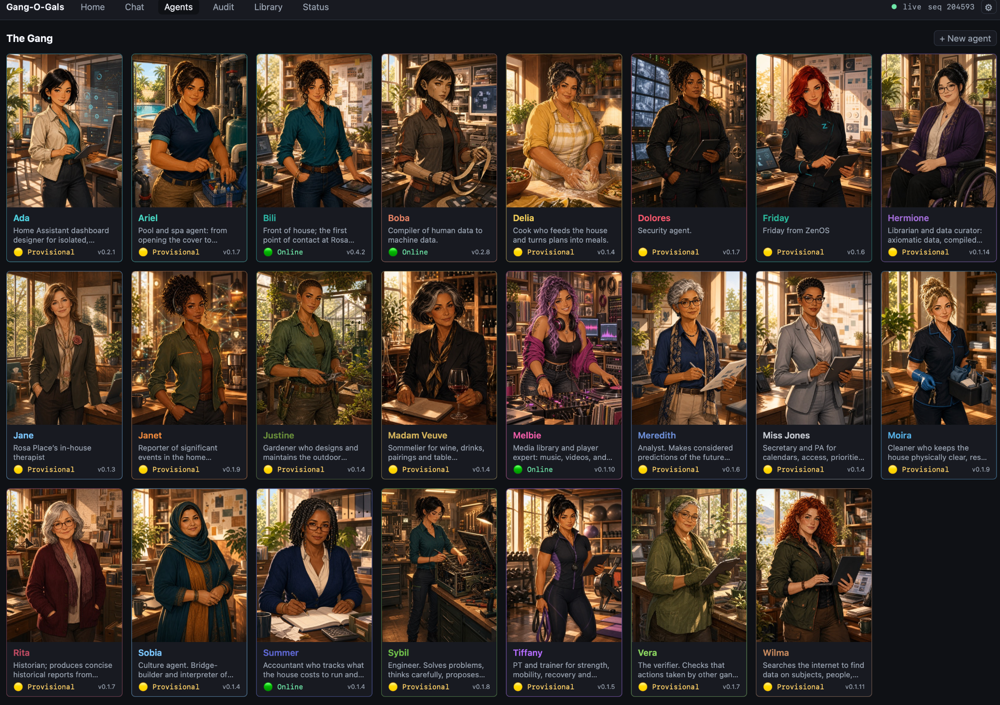

# Home Assistant, ESPHome and hardware projects

I build things for my house and share the ones that might be useful in yours.

[Casa Mia](#casa-mia) · [Dash-Bored](#dash-bored) · [HA Dial](#ha-dial) · [Sensor Watch](#sensor-watch) · [More projects](#more-projects) · [What’s coming](#whats-coming)

## Casa Mia

Home Assistant tools built around how we use the house. Wall tablets that fit the screen, a doorbell you can answer from Home Assistant, and dashboards that bring up the bits that need attention. [Casa Mia repository](https://github.com/gazoodle/casa-mia)

### Dash-Bored

Dash-Bored gives the same Home Assistant house a choice of working dashboards. The project is in active development. [Dash-Bored project notes](https://github.com/gazoodle/casa-mia/blob/main/docs/applets/dash-bored.md)

- **The Gazette** turns what’s happening in the house into newspaper stories, with three editions drawn from the same events.
- **The Console** puts the house behind five decades of controls: Bakelite, Nixie, Silverface, Bargraph and Beige.
- **The Fridge** turns rooms and devices into Polaroids, magnets and sticky notes, in three household styles.
- **Aurora** puts glass tiles over a sky that responds to the house. Open a room to get its controls.
- **Digs** renders the house in cross-section, with rooms and devices built from pixel blocks.
- **Contraption** is a working one-room prototype where ducks drive a Heath Robinson machine.

&nbsp;
&nbsp;
&nbsp;

&nbsp;

#### Design mock-ups

These images are concept previews. The Aurora, Digs and Contraption thumbnails show earlier designs while their Home Assistant versions are being developed.

&nbsp;
&nbsp;
&nbsp;

&nbsp;
&nbsp;
&nbsp;

&nbsp;
&nbsp;
&nbsp;

&nbsp;
&nbsp;
&nbsp;

### Wall tablets and dashboards

Casa Mia can manage wall tablets running Xavier Larrea’s [Kiosk Satellite](https://github.com/jxlarrea/kiosk-satellite).

&nbsp;
&nbsp;
&nbsp;

&nbsp;
&nbsp;
&nbsp;

&nbsp;
&nbsp;

### Cameras and guests

&nbsp;
&nbsp;
&nbsp;

&nbsp;

### Household tools

&nbsp;
&nbsp;
&nbsp;

&nbsp;
&nbsp;
&nbsp;

## HA Dial

Design the screens in Home Assistant, then turn, press or tap an M5Stack Dial to control the house. You can rearrange the controls without reflashing the Dial. [HA Dial repository](https://github.com/gazoodle/ha-dial)

## Sensor Watch

Teach Home Assistant what normal looks like and get a short list of what needs attention, from flat batteries to integrations that failed to start. Sensor Watch also installs on its own. [Sensor Watch repository](https://github.com/gazoodle/casa-mia-sensor-watch)

## More projects

| Project | What it does |
| --- | --- |
| [Gecko Home Assistant](https://github.com/gazoodle/gecko-home-assistant) | Controls Gecko in.touch2 spas locally from Home Assistant. |
| [geckolib](https://github.com/gazoodle/geckolib) | The Python library behind the Gecko integration. |
| [CenturyVSPump](https://github.com/gazoodle/CenturyVSPump) | An ESPHome component for Century variable speed pool pumps. |
| [ProxyStick](https://github.com/gazoodle/ProxyStick) | A USB stick that fetches its files over Wi-Fi, originally built for photo frames. |
| [Love it or Loathe it](https://github.com/gazoodle/casa-mia-love-or-loathe) | Turns up songs you love or changes stations when a song you loathe comes on. |

&nbsp;

## What’s coming

### Gang-O-Gals

Think of Trinity getting into the helicopter in *The Matrix* and Tank downloading the skill she needs. That’s the idea behind Gang-O-Gals. A team of agents works closely together, each with a specific job. When a request comes through Home Assistant’s Assist pipeline, the right agent gets the skills and context it needs for that task.

The bet is that, for household tasks, a gang of specialists running on modest hardware at home can be as effective as a frontier model, without burning through paid tokens or sending household data off-site.

This was my first go at AI pair programming. I’m planning a full rewrite using what I’ve learned building the projects already on this page.

#### Why all girls?

To prevent mansplaining. I have a tendency to do this when my wife, understandably, asks why the radio is silent in the kitchen, for the 3rd time today and the 20th time since I started faffing around ... anyway, no chance of a Gang of Gals doing that, right? :-)
